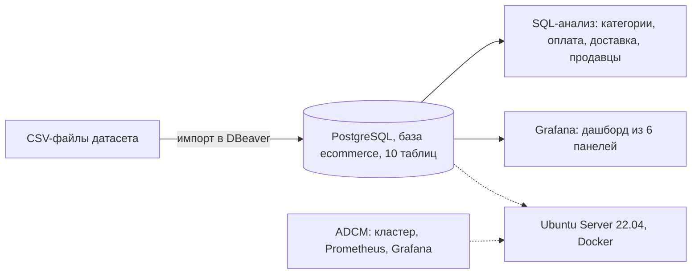
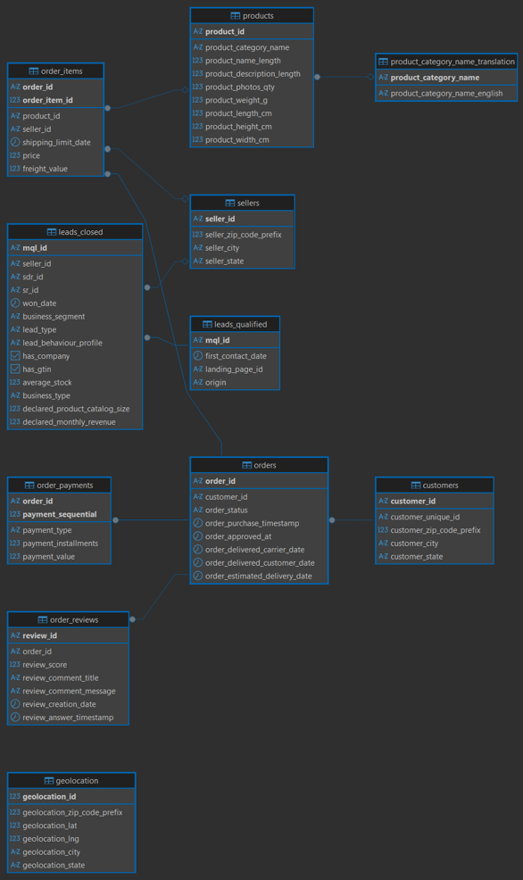
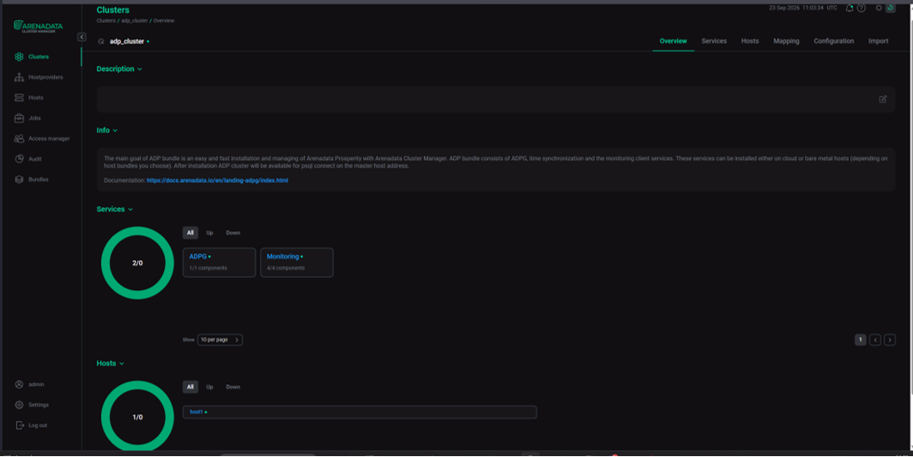
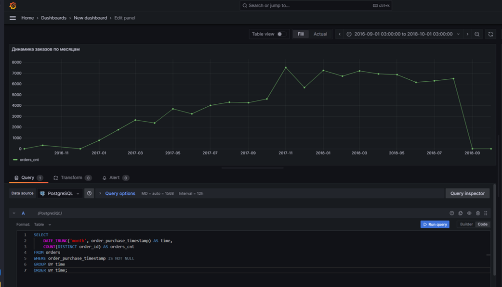
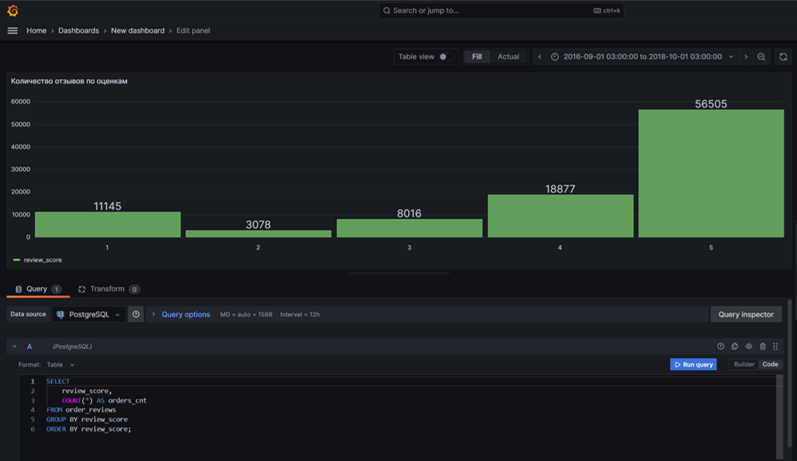
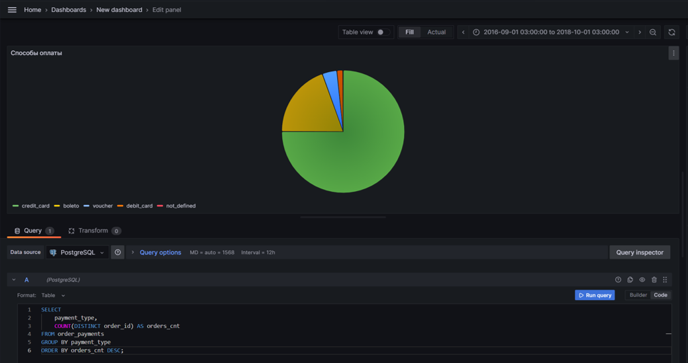
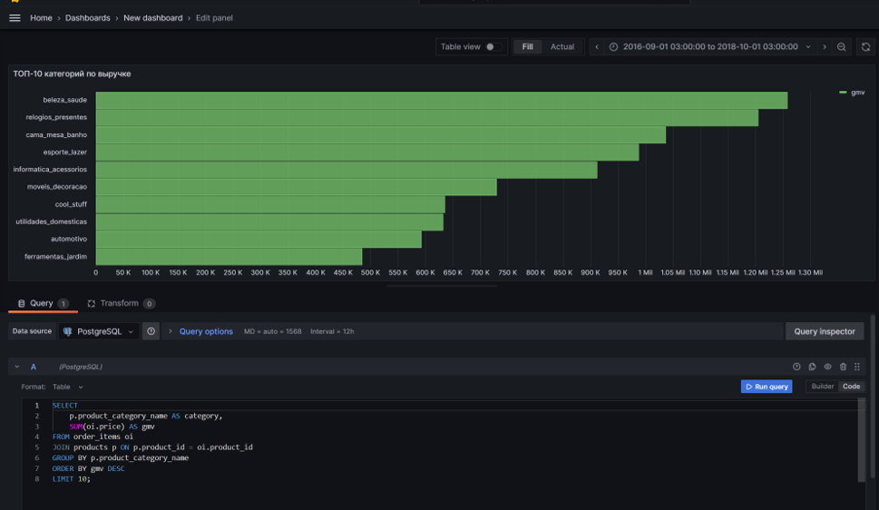
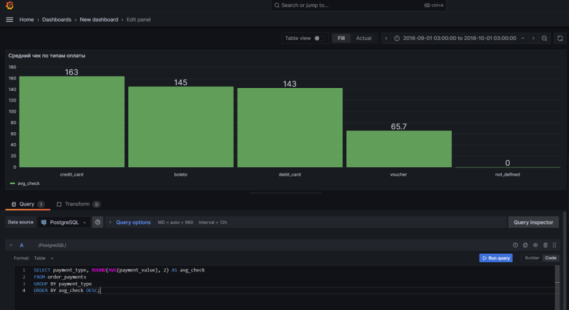
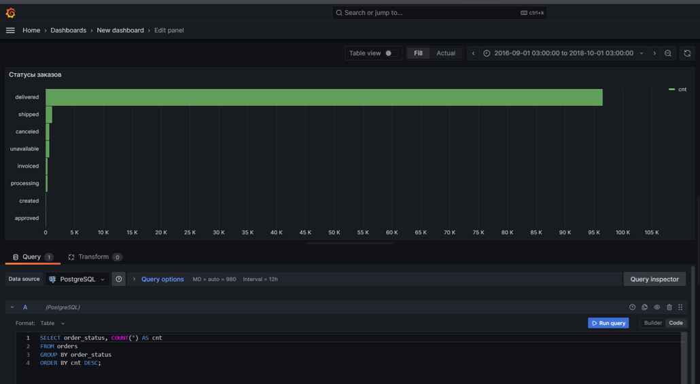

# E-commerce аналитика: PostgreSQL + Docker + Grafana

# Аналитика маркетплейса: SQL-запросы и дашборд в Grafana

Учебный проект. По данным бразильского маркетплейса я загрузила данные в PostgreSQL, ответила на четыре бизнес-вопроса SQL-запросами и собрала дашборд в Grafana из 6 панелей.

> Окружение (виртуальная машина) больше недоступно, поэтому результаты зафиксированы кодом в папке `sql/` и скриншотами в `docs/`.

## Главное

- Выручка маркетплейса сосредоточена в нескольких категориях: `health_beauty`, `watches_gifts` и `bed_bath_table` занимают первые три места.
- Заказы с доставкой дольше 10 дней получают заметно более низкие оценки: 3,90 против 4,43 у заказов с доставкой до 5 дней.
- Три четверти заказов (77 %) оплачиваются кредитной картой, в среднем с рассрочкой на 3,5 платежа.
- Оценки покупателей поляризованы: 58 % пятёрок, но и 11 % единиц при всего 3 % двоек.

## Как устроен проект



**Стек:** PostgreSQL · SQL (JOIN, CTE, агрегаты, подзапросы) · Docker · Arenadata Cluster Manager · Prometheus · Grafana · DBeaver

**Данные:** . Категории товаров на португальском, поэтому в запросах используется таблица переводов. Все суммы в валюте датасета.

## Схема данных



10 таблиц: `geolocation`, `leads_closed`, `product_category_name_translation`, `sellers`, `customers`, `products`, `orders`, `order_items`, `order_reviews`, `order_payments`. Данные импортированы из CSV в порядке зависимостей (справочники, затем заказы и платежи).



Кластер в ADCM: сервисы ADPG и Monitoring (ADPG Exporter, Grafana, Node Exporter, Prometheus Server) запущены в штатном режиме.

## Бизнес-вопросы и результаты

### 1. Какие категории приносят основную выручку?

Запрос: [`sql/01_top_categories.sql`](queries/01_top_categories.sql)

| Категория | Выручка (GMV) | Заказов | Позиций | Выручка на позицию |
|---|---:|---:|---:|---:|
| health_beauty | 1 258 681 | 8 836 | 9 670 | 130 |
| watches_gifts | 1 205 006 | 5 624 | 5 991 | 201 |
| bed_bath_table | 1 036 989 | 9 417 | 11 115 | 93 |
| sports_leisure | 988 049 | 7 720 | 8 641 | 114 |
| computers_accessories | 911 954 | 6 689 | 7 827 | 117 |

Категория `bed_bath_table` лидирует по числу заказов, но выручка на позицию у неё самая низкая (93 против 201 у `watches_gifts`). Рост выручки здесь идёт за счёт частоты покупок, а у часов и подарков за счёт цены.

### 2. Как покупатели платят?

Запрос: [`sql/02_payment_behavior.sql`](queries/02_payment_behavior.sql)

| Способ оплаты | Платежей | Средняя рассрочка | Средний платёж | Доля заказов |
|---|---:|---:|---:|---:|
| credit_card | 76 795 | 3,51 | 163,32 | 76,9 % |
| boleto | 19 784 | 1,00 | 145,03 | 19,9 % |
| voucher | 5 775 | 1,00 | 65,70 | 3,9 % |
| debit_card | 1 529 | 1,00 | 142,57 | 1,5 % |

Доли заказов в сумме больше 100 %, потому что в одном заказе может быть несколько платежей разного типа. Ваучеры используют для небольших платежей (средний 66), вероятно, как частичную оплату.

### 3. Влияет ли скорость доставки на оценку покупателя?

Запрос: [`sql/03_delivery_vs_reviews.sql`](queries/03_delivery_vs_reviews.sql)

| Срок доставки | Отзывов | Средняя оценка |
|---|---:|---:|
| До 5 дней | 19 008 | 4,43 |
| 6–10 дней | 32 408 | 4,35 |
| Более 10 дней | 43 451 | 3,90 |

Чем дольше доставка, тем ниже оценка: разрыв между быстрой и медленной доставкой составляет 0,53 балла. Около 46 % отзывов относятся к заказам, доставленным дольше 10 дней. Это связь, а не доказанная причина: на оценку влияют также категория товара и регион.

### 4. Кто из продавцов лидирует?

Запрос: [`sql/04_seller_efficiency.sql`](queries/04_seller_efficiency.sql)

Топ-10 продавцов по числу заказов (от 1 080 до 1 854 заказов) сильно различаются по выручке: от 37 тыс. до 229 тыс. Лидер по заказам получил 123 тыс. выручки при средней цене позиции около 61, а продавец с 1 132 заказами получил 229 тыс. при средней цене около 199. Это два разных профиля ассортимента: массовый дешёвый и более дорогой.

<details>
<summary>Пример запроса: топ-10 категорий с переводом</summary>

```sql
SELECT
    p.product_category_name        AS category_pt,
    t.product_category_name_english AS category_en,
    SUM(oi.price)                  AS gmv,
    COUNT(DISTINCT oi.order_id)    AS orders_cnt,
    COUNT(*)                       AS items_cnt
FROM order_items oi
JOIN products p ON p.product_id = oi.product_id
LEFT JOIN product_category_name_translation t
       ON t.product_category_name = p.product_category_name
GROUP BY p.product_category_name, t.product_category_name_english
ORDER BY gmv DESC
LIMIT 10;
```

</details>

## Дашборд в Grafana

| | | |
|---|---|---|
| <br>Заказы по месяцам | <br>Распределение оценок | <br>Способы оплаты |
| <br>Топ-10 категорий | <br>Средний платёж по типам | <br>Статусы заказов |

Что видно на дашборде:
- **Динамика заказов:** рост с 2016 по 2018 год, пик около 7 500 заказов в ноябре 2017 (сезон распродаж), затем плато 6–7 тыс. в месяц. Спад в конце графика связан с неполным последним месяцем.
- **Оценки:** 5 звёзд у 57,7 % заказов, 4 у 19,3 %, 3 у 8,2 %, 2 у 3,1 %, 1 у 11,4 %. Доля негативных оценок (1–2) равна 14,5 %.
- **Статусы заказов:** подавляющее большинство заказов доставлено, остальные статусы составляют малую долю.

## Выводы и гипотезы для проверки

Это гипотезы, а не доказанные выводы: данные наблюдательные.

1. **Скорость доставки и рейтинг.** Сократить долю доставок дольше 10 дней. Проверка: сравнить оценки внутри одной категории и региона, затем провести эксперимент с изменением обещанного срока доставки. Метрики: средняя оценка, доля оценок 1–2, повторная покупка.
2. **Рассрочка как инструмент конверсии.** Кредитная карта с рассрочкой доминирует. Проверка: показывать рассрочку на странице оформления и измерять конверсию в оплату и средний чек.
3. **Поляризация оценок.** Единиц в 3,6 раза больше, чем двоек. Нужно выяснить причины (доставка или товар) по категориям и продавцам.
4. **Ассортимент и маркетинг.** Категории различаются по цене и частоте покупок: для `bed_bath_table` важна частота, для `watches_gifts` средний чек.

## Ограничения и что улучшить

- В запросе по продавцам число клиентов совпадает с числом заказов, потому что `customer_id` в этом датасете, по-видимому, создаётся заново на каждый заказ. Для повторных покупок и удержания нужен `customer_unique_id` из таблицы `customers`.
- У части заказов может быть несколько отзывов, поэтому в запросе по доставке считаются отзывы, а не заказы. Корректнее брать один балл на заказ.
- В данных нет сессий и событий пользователей, поэтому нельзя построить воронку по поведению на сайте. Можно построить когортное удержание по `customer_unique_id` и воронку по статусам заказа.
- Оконные функции в этом проекте не использованы; в учебной БД про кофейню они есть.
